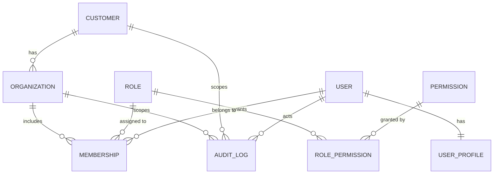

# Auth & Tenancy

> **Status:** design locked, **Phase A implemented** — the `app` schema + migrations live in `apps/api`, the FastAPI API enforces JWT/RBAC/tenancy, and `apps/web` has the Neon Auth wiring, the two-step sign-in UI, and **self-service sign-up with admin approval**. This is the canonical spec for authentication, multi-tenancy, and authorization in `rjs-accounts`. It is written to be read by future maintainers and contributors of this open-source project — every decision includes *why*.

Related docs: [database-schema-design.md](database-schema-design.md) · [api.md](api.md) · root [`AGENTS.md`](../../AGENTS.md)

---

## 0. TL;DR

- **Authentication** (who you are) = **Neon Auth / Managed Better Auth** in the `neon_auth` schema. We never modify it.
- **Authorization** (what you can do) = **our own `app` schema**: `customer → organization → membership → role → permission`.
- **One customer → many organizations.** A user can belong to organizations of different customers.
- **Exactly one role per user, per organization.** Six fixed roles: `owner`, `admin`, `accountant`, `approver`, `auditor`, `viewer`.
- **Platform admin** = `neon_auth.user.role = 'admin'`, external to all orgs, bypasses tenant scoping, seeded by a script.
- **Sign-in** = email + password, **then an email OTP** (a two-step flow we implement on the application layer — see [§13](#13-auth-flows)).
- **All data access goes through FastAPI** (`apps/api`), which verifies the Neon Auth JWT via JWKS and enforces permissions. `apps/web` never talks to Postgres.
- **Tenant isolation** is enforced twice: in the API layer **and** in Postgres **RLS** (fail-closed).

---

## 1. Scope

**In scope (Phase A):** authentication wiring, the `app` schema (customers, organizations, memberships, roles, permissions, audit log), JWT verification in FastAPI, RBAC + tenant enforcement, provisioning flows, and the docs you are reading.

**Out of scope (Phase C):** the finance domain tables (invoices, bills, payments, ledger, parties). The permission catalog already reserves their permissions so RBAC never needs restructuring when they land.

---

## 2. Decision log

Every decision below was made explicitly with the project owner.

| # | Decision | Rationale |
|---|---|---|
| D1 | **Managed Better Auth for identity; our own RBAC for authorization.** | Managed Auth's Organization plugin supports only `owner`/`admin`/`member` and explicitly has *no custom roles/permissions*. We need custom roles, so we own authorization in the database while keeping Managed Auth's zero-maintenance identity. |
| D2 | Auth wiring lives in **`apps/web`**; **FastAPI verifies JWTs now**. | The Managed SDK is JS/Next-native (`@neondatabase/auth/next`). FastAPI then consumes the same JWT via JWKS — no shared session store needed. |
| D3 | **SQLAlchemy 2 + Alembic** own the `app` schema. | Python is already the backend (`apps/api`). Alembic is the standard migration tool for SQLAlchemy. Alembic targets **`app` only** — `neon_auth` is never migrated by us. |
| D4 | **One customer → many organizations.** | Requested: a customer (tenant) can operate several workspaces. |
| D5 | **Six fixed roles**, one per user per org, assignable per org. | The owner needs predictable, auditable roles; letting customers define roles would multiply configuration and support burden. |
| D6 | **Platform admin is external** (`user.role='admin'`), seeded, bypasses tenant scoping. | Admins provision customers/orgs and are not employees of any customer. |
| D7 | Customer registration **and** org activation are admin-gated (not self-service). | Keeps control of who enters the system while the product is young. |
| D8 | **Email + password, then email OTP** (two-step). OTP alone is also allowed. | Requested. Implemented at the app layer because **Managed Auth has no MFA/2FA** (see [§17](#17-risks--limitations)). |
| D9 | **Email:** one **provider-agnostic** app mailer — **Resend** (HTTP API) or **SMTP**, chosen by env — and it sends **auth OTP too**, via a Neon Auth `send.otp` webhook, so sender and template are ours. | Neon has no dashboard email templating, and its shared SMTP always sends from `auth@mail.myneon.app`. Taking delivery over is the only way to satisfy "from our address, in our theme". Switching providers stays a config change, not a code change ([§14](#14-email-strategy)). |
| D10 | Tenant isolation enforced in the **API layer and RLS**. | Defence in depth, per the project's schema guidelines. |
| D11 | `created_at`/`updated_at` everywhere **now**; `app.audit_log` **now**. | There is an `auditor` role and admin-gated flows; both are cheap to add now and expensive to retrofit. |
| D12 | All reads/writes via **FastAPI**. | Single authorization choke point; the browser never holds DB credentials. |

---

## 3. Glossary

| Term | Meaning |
|---|---|
| **User** | A person who can sign in. Identity lives in `neon_auth.user` (managed). |
| **Platform admin** | A user with `neon_auth.user.role = 'admin'`. Not a member of any org. Can act on any customer/org. |
| **Customer** | The tenant / billing account (`app.customer`). Owns one or more organizations. |
| **Organization** | A workspace under a customer (`app.organization`). This is the unit of membership and data scoping. |
| **Membership** | The link between a user and an organization, carrying exactly one role (`app.membership`). |
| **Role** | One of six fixed permission bundles (`app.role`). |
| **Permission** | A single `resource:action` capability (`app.permission`). |
| **JWT** | The short-lived (15 min) EdDSA token issued by Neon Auth; FastAPI verifies it via JWKS. |
| **Tenant context** | The active organization for a request, sent by the client as `X-Organization-Id` and validated server-side. |

---

## 4. Findings (baseline at design time)

- **Neon Auth (Managed Better Auth) is already enabled** on the `production` branch, database `neondb`, schema `neon_auth`.
- `neon_auth.user` columns we rely on: `id uuid PK`, `email text unique`, `name`, `emailVerified`, **`role`** (platform admin flag), `banned`, `banReason`, `banExpires`.
- Managed Auth also provisions `organization`, `member`, `invitation` — **these stay unused** (we own tenancy). Documented so nobody "helpfully" starts using them.
- Repo state *at design time* (baseline this spec was written against — all of it is now implemented, see the status line and §18): no ORM, no migrations, no DB code; `apps/api` was an empty FastAPI stub; `apps/web` login page was UI-only.
- Managed Auth *can* send its own verification / OTP / password-reset emails, but we **take OTP and magic-link delivery over with a webhook** and send them ourselves so the sender and template are ours — see [§14](#14-email-strategy).

---

## 5. Architecture

```
        ┌──────────────────────────────────────────────┐
        │ apps/web  (Next.js 16)                       │
        │  • authClient  ──► Neon Auth (Managed)        │
        │  • /api/auth/[...path]  (same-origin proxy)   │
        │  • login / signup / forgot-password / OTP UI  │
        └───────────────┬──────────────────────────────┘
                        │  fetch(..., Authorization: Bearer <JWT>,
                        │            X-Organization-Id: <uuid>)
                        ▼
        ┌──────────────────────────────────────────────┐
        │ apps/api  (FastAPI)                          │
        │  • verify JWT (EdDSA, JWKS)                   │
        │  • resolve user → membership → role → perms   │
        │  • enforce permission + tenant scope          │
        └───────────────┬──────────────────────────────┘
                        ▼
        ┌──────────────────────────────────────────────┐
        │ Lakebase Postgres (branch)                   │
        │  neon_auth  ← managed by Better Auth (read-only to us)
        │  app        ← our schema, created by Alembic, RLS
        └──────────────────────────────────────────────┘
```

**Why the DB is not touched by the web app:** one authorization choke point, no DB credentials in the browser, and the API can be reused by future clients (mobile, CLI).

---

## 6. Identity vs authorization — why the split

Managed Better Auth is excellent at *authentication* but its Organization plugin is **Partial/Beta with fixed roles and no custom permissions**. Our product needs custom roles, so we draw a clean line:

- `neon_auth` = *authentication facts*: identity, credentials, sessions, email verification, platform `role`.
- `app` = *authorization facts*: tenants, workspaces, memberships, roles, permissions, audit.

The only coupling is a foreign key from our tables to `neon_auth.user(id)`. That is a deliberate, documented trade-off (see [§17](#17-risks--limitations)).

---

## 7. Data model

### 7.1 ERD



`USER`, `SESSION`, `ACCOUNT` live in `neon_auth` (managed); everything else is ours.

### 7.2 Relationship summary

| Relationship | Cardinality | Enforced by |
|---|---|---|
| customer → organization | 1:N | `organization.customer_id` FK |
| organization ↔ user | M:N via `membership` | junction table + `unique(organization_id, user_id)` |
| membership → role | N:1 | `membership.role_slug` FK |
| role ↔ permission | M:N via `role_permission` | junction table |

### 7.3 Why one role per user per org

The requirement is "a user has one role in an org, but may have a different role in another org." The `unique (organization_id, user_id)` constraint encodes that directly, so the invariant can never be violated by a bug, a race, or a manual insert.

### 7.4 Tables (schema `app`)

Shared conventions: UUID PKs via `gen_random_uuid()` (core in PostgreSQL 18); `created_at timestamptz not null default now()`; `updated_at timestamptz not null default now()` maintained by the `app.set_updated_at()` trigger; all timestamps `timestamptz` (UTC). `updated_at` is omitted from some DDL below for brevity.

```sql
-- 7.4.1 customer ---------------------------------------------------------
create table app.customer (
  id          uuid primary key default gen_random_uuid(),
  name        text not null check (length(btrim(name)) > 0),
  slug        text not null unique check (slug = lower(slug)),
  status      text not null default 'pending'
              check (status in ('pending','active','suspended','archived')),
  created_by  uuid not null references neon_auth."user"(id) on delete restrict,
  approved_by uuid references neon_auth."user"(id) on delete set null,
  approved_at timestamptz,
  created_at  timestamptz not null default now(),
  updated_at  timestamptz not null default now(),
  check ((status = 'active') = (approved_at is not null))
);

-- 7.4.2 organization -----------------------------------------------------
create table app.organization (
  id          uuid primary key default gen_random_uuid(),
  customer_id uuid not null references app.customer(id) on delete cascade,
  name        text not null check (length(btrim(name)) > 0),
  slug        text not null check (slug = lower(slug)),
  status      text not null default 'pending'
              check (status in ('pending','active','suspended','archived')),
  created_by  uuid not null references neon_auth."user"(id) on delete restrict,
  approved_by uuid references neon_auth."user"(id) on delete set null,
  approved_at timestamptz,
  created_at  timestamptz not null default now(),
  updated_at  timestamptz not null default now(),
  unique (customer_id, slug),
  check ((status = 'active') = (approved_at is not null))
);

-- 7.4.3 role (seeded, fixed) ---------------------------------------------
create table app.role (
  slug        text primary key,
  name        text not null,
  description text,
  rank        integer not null unique,
  created_at  timestamptz not null default now()
);

-- 7.4.4 permission (seeded, fixed) ---------------------------------------
create table app.permission (
  slug        text primary key,
  resource    text not null,
  action      text not null,
  description text,
  created_at  timestamptz not null default now(),
  unique (resource, action),
  check (slug = resource || ':' || action)
);

-- 7.4.5 role_permission (seed) -------------------------------------------
create table app.role_permission (
  role_slug       text not null references app.role(slug) on delete cascade,
  permission_slug text not null references app.permission(slug) on delete cascade,
  created_at      timestamptz not null default now(),
  primary key (role_slug, permission_slug)
);

-- 7.4.6 membership -------------------------------------------------------
create table app.membership (
  id              uuid primary key default gen_random_uuid(),
  organization_id uuid not null references app.organization(id) on delete cascade,
  user_id         uuid not null references neon_auth."user"(id) on delete cascade,
  role_slug       text not null references app.role(slug) on delete restrict,
  status          text not null default 'active'
                  check (status in ('invited','active','suspended','removed')),
  invited_by      uuid references neon_auth."user"(id) on delete set null,
  created_at      timestamptz not null default now(),
  updated_at      timestamptz not null default now(),
  unique (organization_id, user_id)          -- ONE role per user per org
);

-- 7.4.7 user_profile (1:1 with managed user) -----------------------------
create table app.user_profile (
  user_id              uuid primary key references neon_auth."user"(id) on delete cascade,
  must_change_password boolean not null default true,
  last_seen_at         timestamptz,
  created_at           timestamptz not null default now(),
  updated_at           timestamptz not null default now()
);

-- 7.4.8 login_verification (two-step OTP state) --------------------------
create table app.login_verification (
  id           uuid primary key default gen_random_uuid(),
  user_id      uuid not null references neon_auth."user"(id) on delete cascade,
  session_ref  text not null,                -- Better Auth session id (`sid`) when present
  otp_sent_at  timestamptz not null default now(),
  verified_at  timestamptz,
  expires_at   timestamptz not null,
  unique (user_id, session_ref)
);

-- 7.4.9 audit_log ---------------------------------------------------------
create table app.audit_log (
  id              bigint generated always as identity primary key,
  customer_id     uuid references app.customer(id) on delete set null,
  organization_id uuid references app.organization(id) on delete set null,
  actor_user_id   uuid references neon_auth."user"(id) on delete set null,
  actor_role      text,
  action          text not null,
  entity_type     text not null,
  entity_id       text,
  before          jsonb,
  after           jsonb,
  ip              inet,
  user_agent      text,
  created_at      timestamptz not null default now()
);
```

**Removal semantics.** Removing a member is a **hard delete** of the `membership` row plus an `audit_log` entry. This keeps `unique (organization_id, user_id)` meaningful forever and prevents "removed" rows from accumulating. History is the audit log, not the membership table.

**Why a `user_profile` table.** We cannot add columns to the managed `neon_auth.user`, so first-login state (`must_change_password`) lives in a 1:1 extension keyed by the same `user_id`.

**Why `login_verification`.** Managed Auth issues a session on password sign-in and has no native MFA. This table is the small amount of state that lets us require the OTP step before the session is allowed to read data (see [§13.2](#132-two-step-sign-in-password--otp)).

---

## 8. Roles & permissions

### 8.1 Permission catalog

Permissions are `resource:action`. Phase-C resources are seeded now so the RBAC model is stable from day one.

| Resource | Actions |
|---|---|
| `org` | `read`, `update`, `delete`, `settings` |
| `member` | `read`, `invite`, `update`, `remove`, `role_manage` |
| `account` | `read`, `create`, `update`, `delete` |
| `journal` | `read`, `create`, `update`, `delete`, `post`, `approve` |
| `invoice` | `read`, `create`, `update`, `delete`, `send`, `approve` |
| `bill` | `read`, `create`, `update`, `delete`, `approve` |
| `payment` | `read`, `create`, `update`, `approve` |
| `party` | `read`, `create`, `update`, `delete` |
| `report` | `read`, `export` |
| `audit` | `read` |

### 8.2 Role matrix

| Permission | owner | admin | accountant | approver | auditor | viewer |
|---|:--:|:--:|:--:|:--:|:--:|:--:|
| `org:read` | ✓ | ✓ | ✓ | ✓ | ✓ | ✓ |
| `org:update` | ✓ | ✓ | | | | |
| `org:delete` | ✓ | | | | | |
| `org:settings` | ✓ | ✓ | | | | |
| `member:read` | ✓ | ✓ | | | ✓ | |
| `member:invite` · `member:update` · `member:remove` · `member:role_manage` | ✓ | ✓ | | | | |
| `account:read` | ✓ | ✓ | ✓ | ✓ | ✓ | ✓ |
| `account:create` · `account:update` | ✓ | ✓ | ✓ | | | |
| `account:delete` | ✓ | ✓ | | | | |
| `journal:read` | ✓ | ✓ | ✓ | ✓ | ✓ | ✓ |
| `journal:create` · `journal:update` | ✓ | ✓ | ✓ | | | |
| `journal:delete` | ✓ | ✓ | | | | |
| `journal:post` | ✓ | ✓ | ✓ | | | |
| `journal:approve` | ✓ | ✓ | | ✓ | | |
| `invoice:read` | ✓ | ✓ | ✓ | ✓ | ✓ | ✓ |
| `invoice:create` · `invoice:update` | ✓ | ✓ | ✓ | | | |
| `invoice:delete` | ✓ | ✓ | | | | |
| `invoice:send` | ✓ | ✓ | ✓ | | | |
| `invoice:approve` | ✓ | ✓ | | ✓ | | |
| `bill:read` | ✓ | ✓ | ✓ | ✓ | ✓ | ✓ |
| `bill:create` · `bill:update` | ✓ | ✓ | ✓ | | | |
| `bill:delete` | ✓ | ✓ | | | | |
| `bill:approve` | ✓ | ✓ | | ✓ | | |
| `payment:read` | ✓ | ✓ | ✓ | ✓ | ✓ | ✓ |
| `payment:create` · `payment:update` | ✓ | ✓ | ✓ | | | |
| `payment:approve` | ✓ | ✓ | | ✓ | | |
| `party:read` | ✓ | ✓ | ✓ | ✓ | ✓ | ✓ |
| `party:create` · `party:update` | ✓ | ✓ | ✓ | | | |
| `party:delete` | ✓ | ✓ | | | | |
| `report:read` | ✓ | ✓ | ✓ | ✓ | ✓ | ✓ |
| `report:export` | ✓ | ✓ | ✓ | ✓ | ✓ | |
| `audit:read` | ✓ | ✓ | | | ✓ | |

**Intent.** `owner`: everything, including org deletion. `admin`: everything except org deletion. `accountant`: day-to-day data entry and posting, no approvals or user management. `approver`: read + approve only. `auditor`: read-only across all data including the audit log. `viewer`: read-only business data, no audit or user visibility.

---

## 9. Normalization & functional dependencies

All tables are in 3NF/BCNF. Junction tables (`membership`, `role_permission`) carry no partial dependencies.

Functional dependencies:

- `customer.id → {name, slug, status, created_by, approved_by, approved_at}`
- `(customer_id, slug) → organization`
- `(organization_id, user_id) → {role_slug, status}`
- `role.slug → {name, rank}`
- `permission.slug → {resource, action}`
- `(resource, action) → permission`

`audit_log.before` / `after` use **JSONB on purpose** — point-in-time snapshots are genuinely semi-structured. No intentional denormalization exists in Phase A.

---

## 10. Index plan

| Index | Table | Justification |
|---|---|---|
| `unique (slug)` | customer | customer lookup by slug |
| `unique (customer_id, slug)` | organization | org lookup; slugs unique per customer |
| `(customer_id)` | organization | list orgs of a customer |
| `(status)` | customer, organization | admin approval queues |
| `unique (organization_id, user_id)` | membership | **the invariant** + membership lookup |
| `(user_id)` | membership | "which orgs can this user access?" (hot path on every request) |
| `(organization_id, role_slug)` | membership | "who are the accountants in this org?" |
| `(role_slug)` | role_permission | permission resolution for the current role |
| `(organization_id, created_at desc)` | audit_log | org audit feed |
| `(actor_user_id, created_at desc)` | audit_log | "what did this user do?" |
| `(entity_type, entity_id)` | audit_log | history of one record |

---

## 11. Security & multi-tenancy

### 11.1 Two database roles

| Role | Used by | RLS |
|---|---|---|
| `neondb_owner` | Alembic migrations only | **Bypassed** (table owner) — intentional |
| `app_runtime` (new, `LOGIN`) | FastAPI | **Enforced** (non-owner) |

`DATABASE_URL` (pooled) points at `app_runtime`; `DATABASE_URL_UNPOOLED` (direct) points at the owner and is used only for migrations. Documenting the owner's bypass behaviour is required by the project's schema guidelines.

> **Current state:** the `app_runtime` role does not exist yet ([§17](#17-risks--limitations) risk 6), so **both** URLs use the owner and RLS is inert — the API layer is what enforces tenancy today. The table above is the target setup.

### 11.2 Session variables (set per transaction by FastAPI)

```
SET LOCAL app.user_id            = '<jwt sub>';
SET LOCAL app.organization_id    = '<validated org uuid>';
SET LOCAL app.is_platform_admin  = 'true' | 'false';
```

### 11.3 Policy shape (restrictive), e.g. `app.membership`

```sql
using (
  current_setting('app.is_platform_admin', true) = 'true'
  or organization_id::text = current_setting('app.organization_id', true)
)
```

`current_setting(..., true)` returns `NULL` when unset, so a request that forgets to set context **sees nothing** (fail-closed) instead of leaking another tenant's rows. This is the "won't break" configuration: migrations work (owner bypass), the app is truly constrained, and mistakes deny rather than expose.

### 11.4 Principles

- Authorization is enforced **server-side**, never by hiding UI.
- DB credentials never reach the browser; only `NEON_AUTH_BASE_URL` is browser-facing (through the same-origin proxy).
- Platform admins are the only cross-tenant actors, and that is a single, auditable code path.

---

## 12. Concurrency & integrity

- `unique (organization_id, user_id)` makes "one role per user per org" a **database invariant**.
- Customer/org **approval** uses `select ... for update` to prevent double-approval races; the `(status='active') = (approved_at is not null)` CHECK enforces the pairing.
- Membership changes + audit writes occur in a single transaction.
- FK `on delete` behaviour is chosen deliberately: `cascade` for owned data (org → membership), `restrict` for audit-relevant references (`created_by`), `set null` for optional approvals.

---

## 13. Auth flows

### 13.1 Account lifecycle (self-service, admin-approved)

A user requests access; an administrator grants it. Registration is self-service but never self-approving — the identity is email-verified, then a platform admin activates the account:

1. User signs up at `/sign-up` (same UI/UX as sign-in): name, email, password, consents. Neon Auth stores the identity.
2. A **verification OTP** is emailed; the user confirms it (`emailOtp.verifyEmail`). The account now exists but can read nothing.
3. The web app calls `POST /auth/register`, which creates `app.user_profile` in **`pending`** (idempotent; requires `emailVerified`).
4. The platform admin reviews pending accounts at `/admin/users` → **Approve** (`status = 'active'` + `approved_by`/`approved_at`) or **Decline** (`rejected`). Every decision is audit-logged.
5. Only `active` accounts can read data. Organization membership is assigned separately by an owner/admin via the members endpoint (add-by-email), which is how the first **owner** of a customer gets provisioned once the customer exists.
6. **Bootstrap:** the first platform admin cannot approve themselves through the UI — run `uv run seed-admin <email>` (sets `neon_auth.user.role = 'admin'`). Platform admins skip the approval gate.

`status` mirrors `customer`/`organization`: `pending → active | rejected`, plus `suspended`, with the same `(status='active') = (approved_at is not null)` CHECK.

### 13.2 Two-step sign-in (password → OTP)

Managed Auth has **no MFA/2FA** (it is on their roadmap; see [§17](#17-risks--limitations)). We therefore implement the two-step flow on the application layer, composing two supported primitives — `signIn.email` and `emailOtp` — and gating data access on the result.

```
 ┌────────────┐  1. email + password    ┌──────────────┐
 │  Browser   │ ──────────────────────► │  Neon Auth   │  session issued
 └─────┬──────┘   signIn.email          └──────────────┘
       │  2. app records "pending verification" (app.login_verification)
       │  3. emailOtp.sendVerificationOtp  ──► Neon Auth delivers the code
       ▼
   ┌───────────────────────────────────────────────────────────┐
   │ Until verified, FastAPI rejects data requests with        │
   │   403 { "code": "otp_required" }                          │
   └───────────────────────────────────────────────────────────┘
       │  4. user submits the code → signIn.emailOtp
       │  5. app marks app.login_verification.verified_at
       ▼
   data requests now succeed
```

- The OTP itself is **sent and validated by Managed Auth** (no custom OTP infrastructure).
- The **gate lives in FastAPI**: a session that never completes the OTP step can authenticate but cannot read or write data.
- The verification record is **per user** (the latest row wins) and expires with the session window. It is keyed on the user rather than the session because completing the OTP step makes Managed Auth issue a fresh token; `session_ref` is stored for traceability.
- OTP-only sign-in (without the password step) remains available.
- The gate also enforces **account approval**: a `pending`/`rejected`/`suspended` account that *has* passed the OTP step gets `403` with `X-Account-Status` until an administrator activates it. `/me`, `/auth/register`, and `/auth/login/verification/*` use `get_principal` directly so a not-yet-approved user can still bootstrap and see their own state.
- **The web app mirrors the gate in routing.** `apps/web/proxy.ts` calls a visitor signed in only when they hold a session *and* are not mid-OTP: `/login` and `/sign-up` redirect to `/dashboard` for anyone already signed in (sign out to get them back), while a half-finished sign-in keeps `/login` so it can type the code that is waiting. The check reads `GET /api/v1/auth/login/verification` through the same-origin `/api/verification` relay, and skips the lookup entirely when no session cookie is present. `/pending` is deliberately not redirected — an unapproved account belongs there.

### 13.3 Password reset

Managed Auth `requestPasswordReset` → emailed code/link → `resetPassword`. Available in Phase A.

### 13.4 Per-request authorization (FastAPI)

1. Verify `Authorization: Bearer <JWT>` against `NEON_AUTH_JWKS_URL` (EdDSA).
2. Confirm the login-verification gate is satisfied for the session.
3. Confirm the account is approved (`active`), unless the caller is a platform admin.
4. Read `neon_auth.user.role` by `sub` → platform admin?
5. Read `X-Organization-Id` → confirm an `active` `app.membership` for (`sub`, org).
6. Load the role's permissions.
7. Enforce the required permission before the operation.

### 13.5 Rate limiting

Managed Auth runs better-auth's own limiter, but Neon exposes **no way to
configure it**, and its defaults are short and burst-shaped (3 requests / 10 s on
`/sign-in*` and `/sign-up*`, 3 / 60 s on `/email-otp/send-verification-otp`).
They also count *requests*, not *targets* — nothing in Neon stops one address
from being flooded. The limits are therefore ours, and they live in two places,
because the OTP is sent and checked by Managed Auth: the only chokepoint the app
controls is the same-origin auth proxy.

| Layer | Covers | Counter |
|---|---|---|
| **Web auth proxy** (`apps/web/lib/auth/rate-limit.ts`) | the Managed Auth calls the browser makes: `sign-in/email`, `sign-up/email`, `email-otp/send-verification-otp`, `sign-in/email-otp`, `email-otp/verify-email`, `email-otp/check-verification-otp` | in-process fixed window — **per server instance** |
| **FastAPI** (`apps/api/src/api/services/rate_limit.py`) | the endpoints the API owns: `/auth/login/verification/start`, `/…/complete`, `/auth/register` | `app.rate_limit` — shared and durable |

Two keys are used where it matters: the **client IP** (one source spraying many
accounts) and the **email** from the request body (one inbox or account being
hammered). The IP key trusts the platform's `X-Forwarded-For`; the email key does
not depend on it and is the stronger of the two.

| Route | Per IP | Per email |
|---|---|---|
| `sign-in/email` | 10 / 15 min | 5 / 15 min |
| `sign-up/email` | 5 / hour | — |
| `email-otp/send-verification-otp` | 20 / 15 min | 5 / 15 min |
| `sign-in/email-otp` | 30 / 15 min | 10 / 15 min |
| `email-otp/verify-email` | 30 / 15 min | 10 / 15 min |
| `email-otp/check-verification-otp` | 30 / 15 min | 10 / 15 min |
| FastAPI `/auth/login/verification/start` | — | 10 / 15 min (per **user**) |
| FastAPI `/auth/login/verification/complete` | — | 20 / 15 min (per **user**) |
| FastAPI `/auth/register` | — | 5 / hour (per **user**) |

- Every hit is counted **before** the request is served, so blocked attempts keep
  counting — which is what makes a limit hold against a brute-force loop.
- A blocked request gets **`429`** with `Retry-After` and `X-RateLimit-*`; the
  client shows the same "too many attempts" copy whether the limit was hit at
  Managed Auth, at the proxy, or at FastAPI (the relays pass the headers through).
- The FastAPI counters live in `app.rate_limit` — one row per `(bucket, subject)`,
  recycled in place, written in their own transaction so a `429` can never roll
  the increment back. The table is not under RLS: the limiter runs before (and
  without) a tenant, and the counters hold no tenant data.
- The web counters are **per server instance** — exact on one process, a multiple
  of the limit when several run in parallel. Sharing them would need
  infrastructure the app does not have; better-auth's own limiter is the backstop.

---

## 14. Email strategy

The application talks to a **provider-agnostic mailer** (env-configured). It supports **Resend** (HTTP API) and **SMTP**; the transport is auto-detected — `RESEND_API_KEY` set → Resend, else `SMTP_HOST` set → SMTP, else the message is **logged** (development). Force one with `MAIL_PROVIDER=resend|smtp|auto`. `MAIL_FROM` is the shared `From` address for every transport (falls back to `SMTP_FROM`). Two distinct email sources exist:

| Source | Emails | Dev | Now (no business domain) | Later |
|---|---|---|---|---|
| **Our app** (`apps/api`, `mailer.py`) | sign-in OTP, verification OTP, password-reset links, temp-password / provisioning notices | logged (no transport) | Resend (`RESEND_API_KEY`) or Gmail SMTP | Resend |
| **Neon Auth** | *(only what our webhook does not take over)* | Neon shared SMTP (free, zero config) | Neon shared SMTP | custom SMTP |

### 14.1 OTP delivery runs through our mailer (Neon Auth webhooks)

By default Managed Auth sends its own verification/OTP mail from its shared SMTP (`auth@mail.myneon.app`) using its own template. Neon exposes **no dashboard email templating**, so the only way to control both the **sender address** and the **template** is to take the delivery over with a **webhook**. We do:

1. The branch's Neon Auth webhook is subscribed to **`send.otp`** and **`send.magic_link`** (project-scoped, one per branch).
2. When an OTP/link is created, Neon **skips its own email** and POSTs the event to **`POST /api/v1/auth/webhooks/neon`**.
3. That endpoint **verifies an Ed25519 detached JWS** signature (`X-Neon-Signature`, `X-Neon-Signature-Kid`, `X-Neon-Timestamp`) against the Neon Auth JWKS, rejects deliveries older than five minutes, and ignores replays of the same `X-Neon-Event-Id`.
4. It renders the branded template (`apps/api/src/api/emails.py`) — same palette as the app (`#2d803d` / `#2b66a9`, card `#fffafa`), the code shown as the **same 2–2–2 pairs** as the OTP input — and sends it through `mailer.py`, so it leaves from `MAIL_FROM`.

Consequences worth knowing:

- **The app mailer is now production-critical** — with no transport configured, the webhook answers **503** rather than pretending to succeed, so a code is never silently dropped (Neon retries; the user sees an error).
- **Neon's `customize-emails` guide is the reference** (`https://neon.com/docs/auth/guides/customize-emails`). `customize-email` → webhook is the supported path; there is no template editor.
- Setting the **application name** in the Neon Auth config (`update_auth_config`) still matters for anything Neon itself sends (e.g. organization invitations).
- Everything is **per branch**: enabling the webhook on a dev branch leaves production on Neon's sender until it is enabled there too.
- Managed Auth's shared SMTP (`auth@mail.myneon.app`) remains the zero-config fallback while a branch has no webhook.
- Because the project currently has a **normal Gmail account, not a business domain**, the mailer sends through **Gmail SMTP** (`MAIL_PROVIDER=smtp`, `smtp.gmail.com:587`) authenticated as `team.rjsconsultancy@gmail.com` with a Google **app password** (`SMTP_PASSWORD`). Resend cannot send *from* a `gmail.com` address — it rejects unverified domains with `403`.
- Resend (or any provider) needs a **verified sending domain** for delivery to arbitrary recipients; switching transports stays an env change, not a code change.

### 14.2 Registering the webhook

The webhook lives on the FastAPI service and needs a **public HTTPS URL** — in local development that means a tunnel (e.g. `cloudflared tunnel --url http://localhost:8000` or `ngrok http 8000`). Register it once per branch:

```bash
# Console: Project → Settings → Auth → Webhooks → Add
#   URL:    https://<public-host>/api/v1/auth/webhooks/neon
#   Events: send.otp, send.magic_link

# …or with the Neon CLI (--enabled is required; --url must be the full path):
neon neon-auth config webhook get
neon neon-auth config webhook update \
  --project-id fancy-union-18717305 --branch production \
  --enabled \
  --url https://<public-host>/api/v1/auth/webhooks/neon \
  --enabled-events send.otp send.magic_link
```

**Current state (Oct 2026).** The `production` branch has the webhook **enabled** for `send.otp` + `send.magic_link`, pointing at a Cloudflare **quick tunnel** to the local API (`cloudflared tunnel --url http://localhost:8000` → an ephemeral `https://<name>.trycloudflare.com`).

- The tunnel URL exists only while that process runs and **changes on every restart**, so re-run `webhook update --url …` after restarting the tunnel. Read the live value any time with `neon neon-auth config webhook get`.
- If the tunnel is down, Neon's webhook delivery fails and the code is not sent (Neon retries); the branch falls back to nothing until the URL is restored.
- Verified end-to-end: a sign-in OTP arrived rendered by `emails.py` with Resend `last_event: delivered` (Resend was the transport then). The mailer is now configured for **Gmail SMTP**, sending from `RJS Accounts <team.rjsconsultancy@gmail.com>`; it needs a Google **app password** in `SMTP_PASSWORD` before that transport can authenticate.

There is no MCP tool for webhooks or the email provider — use the Console, the CLI, or the Neon REST API.

The endpoint is public by design (Neon has no bearer token); **the signature check is the authentication**. It must not be placed behind an auth dependency, and it must read the **raw body** before parsing so the signature stays valid.

### 14.3 Other app email

The app mailer also handles mail that is purely ours — provisioning notices and temp passwords for `POST /organizations/{id}/members` — with `send_email(..., html=...)` for a rich alternative to the plain-text body.

---

## 15. API surface (FastAPI, Phase A)

All routes are under `/api/v1` and require a verified JWT unless noted.

| Method | Path | Permission | Notes |
|---|---|---|---|
| `GET` | `/me` | authenticated | user, `platform_role` (raw) + `is_platform_admin`, `account_status`, memberships, `must_change_password` |
| `GET` | `/roles` · `/permissions` | authenticated | reference data |
| `POST` | `/auth/register` | authenticated | create own `user_profile` in `pending` (idempotent; requires `emailVerified`) |
| `GET` | `/auth/login/verification` | authenticated | read the sign-in OTP step state |
| `POST` | `/auth/login/verification/start` · `/complete` | authenticated | open / satisfy the sign-in OTP step |
| `POST` | `/auth/webhooks/neon` | **public — Ed25519 signature is the auth** | Neon Auth `send.otp` / `send.magic_link` delivery; sends the branded email via `mailer.py` ([§14.1](#141-otp-delivery-runs-through-our-mailer-neon-auth-webhooks)) |
| `GET` | `/users` | platform admin | approval queue; `?status=pending\|active\|suspended\|rejected` |
| `POST` | `/users/{id}/approve` · `/users/{id}/reject` | platform admin | activate / decline an account |
| `GET` | `/customers` | platform admin | list tenants |
| `POST` | `/customers` | platform admin | create + activate a customer |
| `GET` | `/organizations` | `org:read` (scoped) | admin sees all; others see their orgs |
| `POST` | `/organizations` | `owner`/`admin` of customer | creates `pending` org |
| `POST` | `/organizations/{id}/approve` | platform admin | `pending → active` |
| `GET` | `/organizations/{id}/members` | `member:read` | |
| `POST` | `/organizations/{id}/members` | `member:invite` | adds an **existing** user (looked up by email); temp-password email is a follow-up |
| `PATCH` | `/organizations/{id}/members/{user_id}` | `member:role_manage` | change role |
| `DELETE` | `/organizations/{id}/members/{user_id}` | `member:remove` | hard delete + audit |
| `GET` | `/audit-logs` | `audit:read` | org-scoped |

The login-verification gate (`otp_required`) and the account-approval gate apply to every route above except `/me`, `/auth/register`, the verification routes (which must stay reachable by a pending user), and `/auth/webhooks/neon` (which is not an application route at all — Neon Auth calls it before the user has a session, and its Ed25519 signature is its authentication). Admin routes (`/users`, `/customers`, org approve) require the OTP step **too** — platform admins don't skip the gate, only the approval check.

---

## 16. Migrations

- Alembic lives in **`apps/api`**. `env.py` targets schema **`app` only**; `neon_auth` is excluded from `include_schemas` and from the version table.
- **0001** — schema `app`, `app.set_updated_at()`, all `app` tables, indexes, and RLS policies. (The `app_runtime` role and its grants are a separate hardening step — see [§17](#17-risks--limitations) risk 6.)
- **0002** — seed `role`, `permission`, and `role_permission`.
- **0003** — account approval: `user_profile.status` (`pending`/`active`/`suspended`/`rejected`), `approved_by`, `approved_at`, CHECK constraints, index; backfills pre-existing profiles to `active`.
- Deploy to a **branch first**, verify, then production. No destructive statements. `neon_auth` is never altered.

---

## 17. Risks & limitations

1. **No native MFA.** The password → OTP flow is enforced at the application layer, not by the auth server. A valid Managed Auth session technically exists after the password step; our API is what refuses to serve data until the OTP is verified. If true server-enforced MFA becomes a hard requirement, the options are (a) self-managed Better Auth, or (b) a stricter proxy that withholds the session cookie until OTP completes.
2. **Cross-schema FKs to `neon_auth.user`.** Real referential integrity, but couples us to the managed schema. `user.id` is a stable contract; if it ever changes, the FKs degrade to validated `uuid` columns.
3. **No custom JWT claims.** Every request performs an authorization lookup. Mitigated by indexing and by caching per-request within a handler.
4. **Resend requires a verified domain** — deferred until a domain exists; Gmail/shared SMTP bridge the gap at no cost.
5. **Branch isolation.** Each database branch has its own Auth URL *and its own users*. Development users are distinct from production users by design.
6. **A second DB role** (`app_runtime`) must be created, with a separate connection secret. Runtime `DATABASE_URL` changes accordingly.
7. **Email deliverability** from Gmail SMTP is lower than a dedicated provider; acceptable for now, revisit with Resend.
8. **Rate limits are partly per-process.** The web auth proxy's counters (which
   cover the Managed Auth OTP calls — see [§13.5](#135-rate-limiting)) live in
   memory, so they are exact on one server instance and a multiple of the limit
   when several run in parallel; the IP key also trusts the platform's
   `X-Forwarded-For`. The email key is unaffected, and better-auth's own limiter
   is the backstop. Sharing the counters (Redis) is the fix if the app scales out.

### Open questions

- **Production origin(s)** for Neon Auth trusted domains, and the eventual Resend sending domain. *(Deferred; not blocking Phase A.)*
- Whether to harden the OTP gate at the proxy/session layer later (see risk 1).

---

## 18. Contributor guide

### Prerequisites

- Node ≥ 24, pnpm `11.25.0` (monorepo), Python + `uv` (backend).
- A Neon project with Auth enabled (inherited from the `.neon` link).

### Environment

`apps/web/.env.local` (see `.env.example`) — the `NEON_AUTH_BASE_URL` and `NEON_AUTH_COOKIE_SECRET` values, plus `API_BASE_URL` (the FastAPI origin, used **server-side only** in the route handlers/relay, so no `NEXT_PUBLIC_` prefix). Generate the cookie secret with `openssl rand -base64 32`. The web app holds **auth values + the API base URL only** — never DB or storage credentials (those belong to `apps/api`).

`apps/api/.env` — `HOST` and `PORT` (the local dev bind address), `DATABASE_URL` (pooled), `DATABASE_URL_UNPOOLED` (direct, migrations), `NEON_AUTH_JWKS_URL`, `NEON_AUTH_BASE_URL`, `ENVIRONMENT`, `CORS_ORIGINS` (must include the web origin, e.g. `["http://localhost:3000"]`), `APP_NAME` (branding in emails), and the mailer settings (`MAIL_PROVIDER`, `MAIL_FROM`, plus the transport credentials — `SMTP_*` for Gmail/Resend SMTP, or `RESEND_API_KEY` for the Resend HTTP API). The mailer is production-critical now that it delivers the sign-in OTP ([§14.1](#141-otp-delivery-runs-through-our-mailer-neon-auth-webhooks)), so a transport and `MAIL_FROM` must be set wherever the webhook is registered. Until the `app_runtime` role exists ([§17](#17-risks--limitations) risk 6) both URLs use the owner role: RLS is in place but bypassed by the owner, so **the API layer is what enforces tenancy today**.

Neither app has in-code defaults for these values: every required variable must be set (the API pulls the branch database + Auth values with `neon env pull --service postgres,auth --file apps/api/.env`), and a missing one fails fast at startup.

### Common commands

```sh
pnpm dev                             # turbo: web (:3000) + api (:8000)
pnpm lint                            # biome
pnpm --filter web check-types        # web types
pnpm --filter web build              # web build

cd apps/api
uv run api                           # backend alone (host/port from .env)
uv run alembic upgrade head          # apply migrations
uv run alembic revision --autogenerate -m "message"
uv run seed-admin someone@example.com # grant platform admin
```

### Rules that must not be broken

- **HugeIcons only** in the web app (`@hugeicons/*`).
- Static data lives in `apps/web/lib/data/`; schemas in `apps/web/lib/validations/` (never inline in a page).
- **Never** modify or migrate the `neon_auth` schema.
- Enforce authorization on the server; never rely on hiding UI.
- Follow [database-schema-design.md](database-schema-design.md) for any schema change.

### Where things live

| Concern | Location |
|---|---|
| Auth client/server (web) | `apps/web/lib/auth/` |
| Auth proxy route | `apps/web/app/api/auth/[...path]/route.ts` |
| Same-origin relay → FastAPI | `apps/web/app/api/backend/[...path]/route.ts` |
| Auth screens (login / sign-up / pending) | `apps/web/app/(login)/` |
| Admin approval queue | `apps/web/app/(application)/admin/users/` |
| Route protection + auth-page redirects | `apps/web/proxy.ts` (Next 16 middleware) |
| Backend app | `apps/api/src/api/` |
| Models / migrations | `apps/api/src/api/models/`, `apps/api/alembic/` |

---

## 19. Verification plan

- `alembic upgrade head` on a **branch**; confirm all `app` objects and constraints exist.
- Seed check: `select role_slug, count(*) from app.role_permission group by role_slug`.
- Auth: sign-up (email-verified OTP) → `POST /auth/register` lands the profile `pending` → admin (`GET /users?status=pending`) approves → sign-in → **OTP step** → sign-out → session reload → protected route.
- Approval gate: a `pending` account gets `403` (`X-Account-Status: pending`) on data routes; `/me` still returns its status so the UI can bootstrap. Approve flips it to `active`; reject clears `approved_at` and re-blocks. `register` is idempotent; only an admin can read the queue.
- Password reset round-trip on shared SMTP.
- Authorization: a `viewer` calling a create endpoint directly is denied `403`; a request for another org's data is denied; a platform admin bypasses.
- Gate: a session that has not completed the OTP step receives `403 otp_required` on data routes.
- Routing: with a session, `/login` and `/sign-up` redirect to `/dashboard` and `/pending` stays reachable; mid-OTP (code pending, unexpired) `/login` stays reachable; after sign-out `/dashboard` redirects back to `/login` and the auth pages render again.
- Rate limits: the sixth `POST /api/auth/sign-in/email` (or `email-otp/send-verification-otp`) for one email in 15 minutes returns `429` with `Retry-After`; the sixth `POST /api/v1/auth/register` for one user returns `429` with `X-RateLimit-*`, and the counter row in `app.rate_limit` survives the rejection (a blocked attempt still counts).
- RLS: as `app_runtime` with no session variables set → **zero rows**; with the correct org → only that org's rows.
